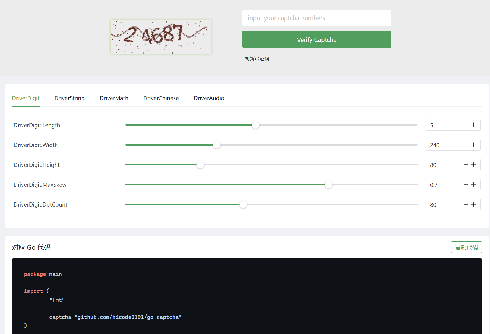
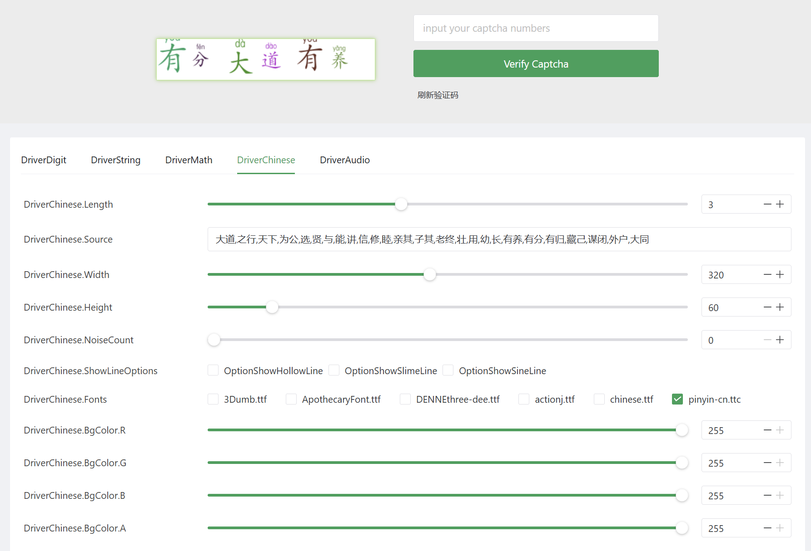

<div align="center">

# go-captcha

**Go 语言图形验证码库** —— 数字 / 字符串 / 算术 / 中文 / 语音，五种验证码开箱即用

[](https://go.dev)
[](#license)
[](docs/USAGE.md)
[]()

*统一输出 base64（PNG / WAV），前端 `` / `<audio>` 直接可用，字体与语音样本全部内嵌，二进制零外部依赖*

</div>

---

## ✨ 特性

- 🎨 **五种验证码引擎** —— 数字点阵、字符串、算术、中文（支持拼音注音字体）、语音
- 🔊 **语音验证码** —— 输出 WAV，支持 `en` / `zh` / `ru` / `ja` 四语发音，随机变速抗机器识别
- 🈶 **中文友好** —— 内嵌汉字字体，候选字集支持逗号分隔词组写法
- 📦 **开箱即用** —— 6 款经典字体与数字语音样本编译期内嵌，部署零外部文件
- 🧩 **接口化设计** —— `Engine` / `Artifact` / `Repository` 三大接口，出题、渲染、存储皆可替换（Redis 等）
- 🛡️ **安全细节** —— 会话 id 与验证码文本均由 CSPRNG 生成（含模偏差消除），校验支持一次性消费防重放
- 🖥️ **Web 调试页** —— 实时调参可视化预览，自动生成等价 Go 接入代码，字体列表跟随 `fonts/` 目录自动更新

## 📦 安装

```bash
go get github.com/hicode0101/go-captcha
```

## 🚀 快速开始

```go
package main

import (
	"fmt"

	captcha "github.com/hicode0101/go-captcha"
)

func main() {
	// 数字验证码引擎：画布高, 宽, 数字个数, 最大倾斜, 背景圆点数
	engine := captcha.NewDigitEngine(80, 240, 5, 0.7, 80)

	svc := captcha.NewService(engine, captcha.DefaultRepository)
	id, b64s, answer, err := svc.Create()
	if err != nil {
		panic(err)
	}
	fmt.Println(id)     // 会话 id，随验证码一起下发给前端
	fmt.Println(b64s)   // data:image/png;base64,... 直接放入 
	fmt.Println(answer) // 调试用：正确答案，生产环境勿下发

	// 校验用户输入；consume=true 表示无论成败都消费掉该验证码（防重放，推荐）
	fmt.Println(svc.Check(id, answer, true))
}
```

## 🧩 各引擎构造参数

| 引擎 | 构造函数参数 | 说明 |
| --- | --- | --- |
| `NewDigitEngine(imageHeight, imageWidth, digitCount, maxSkew, noiseDots)` | 数字点阵验证码，波形扭曲 + 圆点噪声 | 透明背景 PNG |
| `NewStringEngine(imageHeight, imageWidth, noiseCount, lineOptions, textLength, charset, bgColor, fontBox, fontNames)` | 字符串验证码，字符集 / 字体 / 干扰线可配 | 支持 emoji 字符集 |
| `NewMathEngine(imageHeight, imageWidth, noiseCount, lineOptions, bgColor, fontBox, fontNames)` | 算术验证码（加 / 减 / 乘） | 答案为计算结果 |
| `NewChineseEngine(imageHeight, imageWidth, noiseCount, lineOptions, textLength, charset, bgColor, fontBox, fontNames)` | 中文验证码 | `charset` 支持逗号分隔词组 |
| `NewAudioEngine(digitCount, language)` | 语音验证码 | `language` 取 `en` / `zh` / `ru` / `ja` |

<details>
<summary><b>公共参数速查</b></summary>

- `lineOptions`：`LineOptionHollow(2)` / `LineOptionSlime(4)` / `LineOptionSine(8)` 按位或组合，`0` 为不画线
- `bgColor`：传 `nil` 表示每次随机浅色背景，否则 `&color.RGBA{R: 125, G: 125, B: 0, A: 118}`
- `fontNames`：字体文件名列表（如 `[]string{"chinese.ttf"}`），空列表使用全部内嵌字体；`captcha.BuiltinFontNames()` 可枚举
- `fontBox`：自定义字体仓库实现 `captcha.FontBox` 接口，`nil` 使用内嵌仓库

</details>

> 📘 所有参数的详细说明（类型、常用值、边界行为）、仓库选型与生产建议见 **[docs/USAGE.md](docs/USAGE.md)**。

## 🗂️ 代码结构

| 文件 | 职责 |
| --- | --- |
| `doc.go` / `service.go` | 包文档；`Service` 服务入口（引擎 + 仓库的组装与校验） |
| `contract.go` | 三大核心接口：`Engine`（出题渲染）、`Artifact`（产物）、`Repository`（答案仓库） |
| `assets.go` | 字符集、MIME、干扰线选项等常量 |
| `challenge_*.go` | 五种验证码引擎：`DigitEngine` / `StringEngine` / `MathEngine` / `ChineseEngine` / `AudioEngine` |
| `painters.go` / `painters_digit.go` | 图片绘制：字符画布 `CharImage` 与数字点阵 `DotMatrixImage` |
| `audio_dsp.go` / `audio_pcm.go` / `voice_samples.go` | 音频：信号处理、WAV 拼装、内置数字语音样本 |
| `fontbox.go` / `fontbox_builtin.go` | 字体仓库抽象与内嵌字体（随机池 6 款，含中文字体 `chinese.ttf` / `pinyin-cn.ttc`） |
| `randsource.go` / `helpers.go` | 随机文本/颜色/会话 id；数字与落盘工具 |
| `repository_memory.go` / `repository_sync.go` | 内存仓库（默认）与 sync.Map 仓库 |

## 🖥️ Web 调试示例（8090 端口）

`example/web` 是一个可实时调参的可视化调试页（Vue3 + Naive UI + TypeScript）：
拖动滑杆即时预览效果，并自动生成等价的 Go 接入代码。

| 数字验证码调参 + 代码生成 | 中文验证码（拼音注音字体） |
| :---: | :---: |
|  |  |

```bash
# 1. 构建前端
cd example/web/frontend
npm install
npm run build

# 2. 启动服务（默认监听 :8090，自带静态文件服务，-addr 可覆盖）
cd ../server
go run .
# 浏览器打开 http://localhost:8090
```

> 💡 演示服务的字体勾选列表自动跟随 `fonts/` 目录：新增或删除字体文件后**无需重新编译、无需重启**，刷新页面即生效（目录不可读时回退内嵌字体）。

前端开发模式：`npm run dev`（已配置 `/api` 代理到 `:8090`）。接口参数说明见 [docs/USAGE.md](docs/USAGE.md#10-http-接口参数example-后端)。

## 📄 License

[Apache License 2.0](http://www.apache.org/licenses/LICENSE-2.0)
